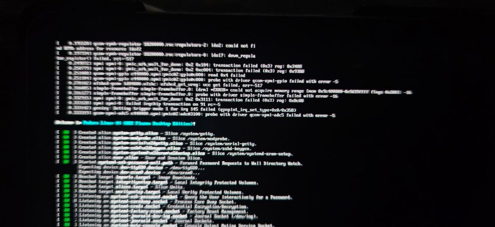
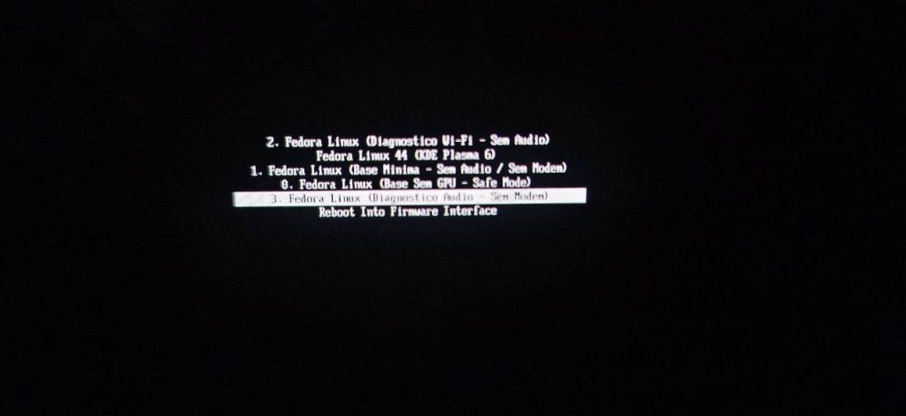

# Mainline Linux on Samsung Galaxy Tab S6 LTE / Wi-Fi (`SM-T865` / `SM-T860`)

[](#) [](README.pt-BR.md) [](LICENSE) [](https://github.com/NarraLume-Project/kernel-mainline) [](https://github.com/NarraLume-Project/mu-msm-gts6l)

> [!NOTE]
> [🇧🇷 Clique aqui para ler a documentação em Português](README.pt-BR.md)

---

## 📸 System Screenshots

<div align="center">
  
  
  <p><em>Real mainline Linux (Fedora 44 aarch64 with KDE Plasma 6) running natively on the internal UFS storage of the Samsung Galaxy Tab S6.</em></p>
</div>

---

## 📖 Project Overview

This project provides a full, native, and hardware-accelerated **Mainline Linux** environment for the **Samsung Galaxy Tab S6** series (Qualcomm **Snapdragon 855** / **SM8150**, codenames `gts6l` and `gts6lwifi`).

This is **not** an Android chroot, container, or virtual machine. It is a native Linux installation running directly on the tablet's high-speed UFS 3.0 internal storage, driven by:
- A custom **Project Mu / EDK2 UEFI firmware** chainloaded past Samsung's locked ABL bootloader.
- An upstream **Linux 6.12 Mainline Kernel** with customized device trees and drivers for the Tab S6 hardware.
- Full **Adreno 640 GPU acceleration** (via Mesa KMSRO and Freedreno).
- Working **multitouch screen**, **Wacom W9021 S-Pen digitizer**, **AKG quad-speaker audio**, **dual-band Wi-Fi**, **Bluetooth**, and **battery management**.

---

## 🔗 Dedicated Project Repositories

The project is structured into three dedicated repositories for modularity and maintainability:

| Repository | Description | Source Code Link |
|---|---|---|
| **Main Repository** | Documentation, precompiled release binaries, rootfs overlays, and deployment tools | [NarraLume-Project/gts6l-linux](https://github.com/NarraLume-Project/gts6l-linux) |
| **Kernel Tree** | Dedicated Linux 6.12 mainline kernel repository with drivers, defconfig, and device trees | [NarraLume-Project/kernel-mainline](https://github.com/NarraLume-Project/kernel-mainline) |
| **UEFI Firmware** | Dedicated Project Mu / EDK2 UEFI firmware repository for Qualcomm SM8150 devices | [NarraLume-Project/mu-msm-gts6l](https://github.com/NarraLume-Project/mu-msm-gts6l) |

---

## 📱 Supported Devices

| Model | Codename | Connectivity | SoC | Display | Storage |
|---|---|---|---|---|---|
| **Samsung Galaxy Tab S6 LTE** | `SM-T865` (`gts6l`) | 4G LTE + Wi-Fi | Qualcomm Snapdragon 855 | 10.5" Super AMOLED (2560x1600) | 128 / 256 GB UFS 3.0 |
| **Samsung Galaxy Tab S6 Wi-Fi** | `SM-T860` (`gts6lwifi`) | Wi-Fi Only | Qualcomm Snapdragon 855 | 10.5" Super AMOLED (2560x1600) | 128 / 256 GB UFS 3.0 |

---

## 📊 Hardware Support Status

| Subsystem | Status | Description |
|---|---|---|
| **UEFI Bootloader** | ✅ Working | Chainloads via Aloha UEFI; sets 2560x1600 GOP framebuffer |
| **Internal UFS 3.0** | ✅ Working | High-speed read/write; `BRANCH_HALT_SKIP` clock fix applied |
| **Display (2560x1600)** | ✅ Working | Native WQXGA 60 Hz via `simpledrm`; software brightness dimming |
| **GPU Acceleration** | ✅ Working | Adreno 640 render-only node via Mesa KMSRO (OpenGL 3.3 / Vulkan) |
| **Touchscreen** | ✅ Working | STMicroelectronics `fts1ba90a` (multitouch & palm rejection) |
| **Wacom S-Pen** | ✅ Working | Wacom W9021 digitizer (4096 pressure levels, tilt, distance, side button) |
| **Quad Speakers** | ✅ Working | 4x Cirrus CS35L41 digital amps via Secondary TDM + ALSA UCM2 |
| **Microphones** | ✅ Working | Cirrus CS48L33 capture over Quinary MI2S |
| **Wi-Fi** | ✅ Working | Qualcomm WCN3990 (802.11ac, up to 866.7 Mbps) |
| **Bluetooth** | ✅ Working | Bluetooth 5.0 UART (`hci_qca`) |
| **Battery & Charging** | ✅ Working | Samsung SM5705 fuel gauge + 2000 mA charging current maintainer |
| **USB Type-C** | ✅ Working | Dual-role: USB 2.0 host (hubs, disks, mice) + RNDIS dev lifeline |
| **Hardware Buttons** | ✅ Working | Power, Volume Down (PMIC PON), and Volume Up (PM8150L GPIO12) |
| **Suspend / Sleep** | ✅ Working | `s2idle` low-power sleep; 1.5s wake-up time |
| **Sensors** | ✅ Working | LSM6DSO accelerometer auto-rotation via SLPI Hexagon DSP |
| **Cellular Audio** | 🟡 WIP | Modem data/SIM works; in-call audio routing in progress |
| **Cameras** | 🔴 Not Working | Spectra 380 ISP needs downstream sensor drivers |
| **Fingerprint Sensor** | 🔴 Not Working | Proprietary in-display optical sensor |

*For a detailed technical breakdown of each subsystem, see [docs/HARDWARE_STATUS.md](docs/HARDWARE_STATUS.md).*

---

## 📚 Documentation Guides

- 📖 **[Complete Installation Guide](docs/INSTALLATION.md)**: Step-by-step instructions from stock Android / Download Mode to a running desktop.
- 🐧 **[Distribution Porting Guide](docs/DISTRO_PORTING.md)**: How to adapt this port to Arch Linux ARM, Debian, Ubuntu, postmarketOS, or Alpine.
- ⚙️ **[Compiling UEFI from Source](docs/UEFI_BUILD_GUIDE.md)**: Toolchain requirements and build commands for the dedicated UEFI repository.
- 🔍 **[Hardware Status & Notes](docs/HARDWARE_STATUS.md)**: In-depth technical status for each peripheral.

---

## 📦 Binary Releases & Large Files Notice

Pre-compiled bootable images are available under the **[Releases](https://github.com/NarraLume-Project/gts6l-linux/releases)** section:
- `boot-uefi.tar.md5`: Odin-flashable AP container containing the patched UEFI bootloader and verification-disabled vbmeta.
- `Image`: Mainline Linux 6.12 kernel image.
- `sm8150-samsung-gts6l.dtb` & `sm8150-samsung-gts6lwifi.dtb`: Compiled device tree blobs.
- `modules-6.12.tar.gz`: Precompiled kernel modules archive.

> [!TIP]
> Binaries tracked in the repository (`bin/`) are configured with **Git LFS**. When cloning, ensure you have `git-lfs` installed:
> ```bash
> git lfs install
> git clone https://github.com/NarraLume-Project/gts6l-linux.git
> ```

---

## 👥 Credits & Acknowledgments

- **[Project-Aloha](https://github.com/Project-Aloha)** — For the SM8150 UEFI firmware port and DualBootKernelPatcher.
- **[DuoWoA Project](https://github.com/WOA-Project)** — For the Project Mu base and Snapdragon platform packages.
- **[Freedreno & Mesa Project](https://gitlab.freedesktop.org/mesa/mesa)** — For the open-source Adreno GPU driver stack.
- **Samsung Electronics & Qualcomm Technologies** — For the Tab S6 hardware platform.

---

## 📄 License

- Documentation, tools, and configuration scripts in this repository are licensed under the **[MIT License](LICENSE)**.
- The Linux Kernel is licensed under **[GPLv2](https://github.com/NarraLume-Project/kernel-mainline/blob/main/COPYING)**.
- The UEFI Firmware is licensed under the **[BSD-2-Clause-Patent License](https://github.com/NarraLume-Project/mu-msm-gts6l/blob/main/LICENSE)**.
