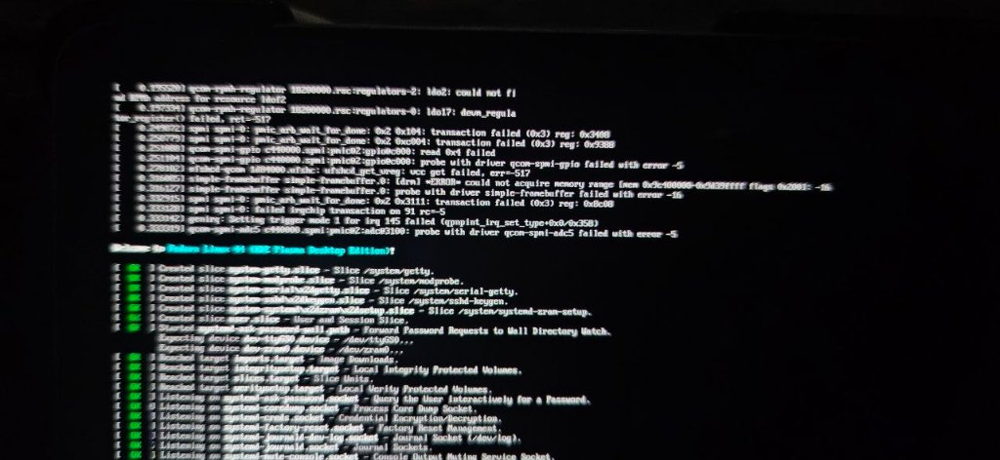
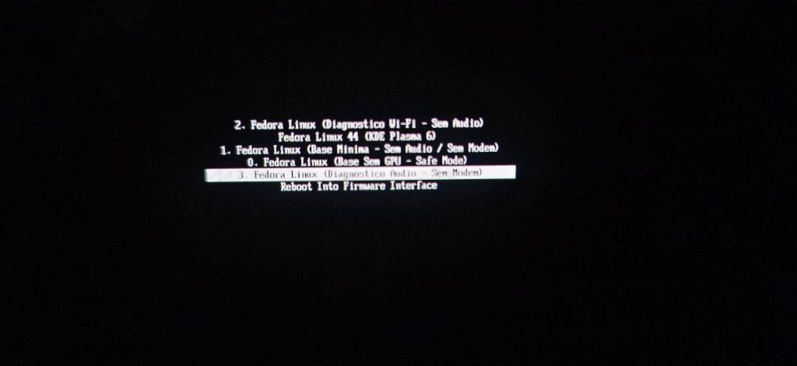

# Linux Mainline no Samsung Galaxy Tab S6 LTE / Wi-Fi (`SM-T865` / `SM-T860`)

[](README.md) [](#) [](LICENSE) [](https://github.com/NarraLume-Project/kernel-mainline) [](https://github.com/NarraLume-Project/mu-msm-gts6l)

> [!NOTE]
> [🇺🇸 Click here to read the documentation in English](README.md)

---

## 📸 Capturas de Tela do Sistema

<div align="center">
  
  
  <p><em>Linux Mainline autêntico (Fedora 44 aarch64 com KDE Plasma 6) rodando nativamente no armazenamento interno UFS do Samsung Galaxy Tab S6.</em></p>
</div>

---

## 📖 Visão Geral do Projeto

Este projeto entrega um ambiente **Linux Mainline** completo, nativo e acelerado por hardware para os tablets da linha **Samsung Galaxy Tab S6** (Qualcomm **Snapdragon 855** / **SM8150**, codinomes `gts6l` e `gts6lwifi`).

Isto **não** é um chroot, contêiner Android ou máquina virtual. Trata-se de uma instalação Linux real operando diretamente no armazenamento UFS 3.0 interno de alta performance, impulsionada por:
- **Firmware UEFI Project Mu / EDK2** inicializado em cadeia após o bootloader ABL da Samsung.
- **Kernel Linux 6.12 Mainline** oficial com drivers e device trees dedicados ao Tab S6.
- **Aceleração Gráfica Total na GPU Adreno 640** (via Mesa KMSRO e Freedreno).
- Suporte a **touchscreen multitouch**, **mesa digitalizadora S-Pen (Wacom W9021)**, **áudio quádruplo AKG**, **Wi-Fi dual-band**, **Bluetooth** e **gerenciamento de energia**.

---

## 🔗 Repositórios do Projeto

Para facilitar a manutenção e organização, o projeto está dividido em três repositórios dedicados:

| Repositório | Descrição | Link do Código-Fonte |
|---|---|---|
| **Repositório Principal** | Documentação, imagens de release, arquivos de configuração do sistema e scripts de instalação | [NarraLume-Project/gts6l-linux](https://github.com/NarraLume-Project/gts6l-linux) |
| **Árvore do Kernel** | Código-fonte do Kernel Linux 6.12 Mainline com drivers, defconfig e device trees | [NarraLume-Project/kernel-mainline](https://github.com/NarraLume-Project/kernel-mainline) |
| **Firmware UEFI** | Código do bootloader UEFI Project Mu / EDK2 para plataformas Qualcomm SM8150 | [NarraLume-Project/mu-msm-gts6l](https://github.com/NarraLume-Project/mu-msm-gts6l) |

---

## 📱 Aparelhos Suportados

| Modelo | Codinome | Conectividade | Processador | Tela | Armazenamento |
|---|---|---|---|---|---|
| **Samsung Galaxy Tab S6 LTE** | `SM-T865` (`gts6l`) | 4G LTE + Wi-Fi | Qualcomm Snapdragon 855 | 10.5" Super AMOLED (2560x1600) | 128 / 256 GB UFS 3.0 |
| **Samsung Galaxy Tab S6 Wi-Fi** | `SM-T860` (`gts6lwifi`) | Apenas Wi-Fi | Qualcomm Snapdragon 855 | 10.5" Super AMOLED (2560x1600) | 128 / 256 GB UFS 3.0 |

---

## 📊 Status do Suporte de Hardware

| Subsistema | Status | Descrição |
|---|---|---|
| **Bootloader UEFI** | ✅ Funcionando | Carrega via Aloha UEFI; inicializa o framebuffer GOP em 2560x1600 |
| **Armazenamento UFS 3.0** | ✅ Funcionando | Alta velocidade de leitura e escrita; correção `BRANCH_HALT_SKIP` nos clocks |
| **Tela (2560x1600)** | ✅ Funcionando | WQXGA nativo a 60 Hz via `simpledrm`; controle de brilho via software |
| **Aceleração de GPU** | ✅ Funcionando | Nó render-only Adreno 640 via Mesa KMSRO (OpenGL 3.3 e Vulkan) |
| **Tela de Toque** | ✅ Funcionando | STMicroelectronics `fts1ba90a` (multitoque e rejeição de palma) |
| **Caneta S-Pen Wacom** | ✅ Funcionando | Digitalizador Wacom W9021 (4096 níveis de pressão, inclinação, hover e botão) |
| **Alto-falantes Quádruplos** | ✅ Funcionando | 4x amplificadores Cirrus CS35L41 via Secondary TDM e ALSA UCM2 |
| **Microfones** | ✅ Funcionando | Captura Cirrus CS48L33 via Quinary MI2S no PipeWire |
| **Wi-Fi** | ✅ Funcionando | Qualcomm WCN3990 (802.11ac dual-band até 866.7 Mbps) |
| **Bluetooth** | ✅ Funcionando | Bluetooth 5.0 operacional via UART (`hci_qca`) |
| **Bateria e Carga** | ✅ Funcionando | Medidor SM5705 + mantenedor contínuo de corrente de 2000 mA |
| **USB Type-C** | ✅ Funcionando | Dual-role: USB 2.0 Host (hubs, discos, mouses) + rede RNDIS de emergência |
| **Botões Físicos** | ✅ Funcionando | Power, Volume Menos (PMIC PON) e Volume Mais (PM8150L GPIO12) |
| **Suspensão e Retomada** | ✅ Funcionando | Modo `s2idle` de baixo consumo com retorno em 1.5s |
| **Sensores** | ✅ Funcionando | Rotação automática via acelerômetro LSM6DSO no DSP Hexagon SLPI |
| **Áudio em Chamadas** | 🟡 Em Progresso | Dados e chip SIM funcionam; roteamento de voz em desenvolvimento |
| **Câmeras** | 🔴 Não Funcional | Processador Spectra 380 requer adaptação de drivers dos sensores |
| **Biometria** | 🔴 Não Funcional | Sensor óptico sob a tela fechado e restrito ao Secure World |

*Para a tabela técnica completa de cada componente, veja [docs/HARDWARE_STATUS.pt-BR.md](docs/HARDWARE_STATUS.pt-BR.md).*

---

## 📚 Guias de Documentação

- 📖 **[Guia Completo de Instalação](docs/INSTALLATION.pt-BR.md)**: Passo a passo desde o Android original até a inicialização do desktop.
- 🐧 **[Como Portar Outras Distribuições](docs/DISTRO_PORTING.pt-BR.md)**: Como instalar Arch Linux ARM, Debian, Ubuntu, postmarketOS ou Alpine.
- ⚙️ **[Compilando o UEFI a partir do Código](docs/UEFI_BUILD_GUIDE.pt-BR.md)**: Instruções de build e toolchains para o repositório dedicado de firmware.
- 🔍 **[Tabela Detalhada de Hardware](docs/HARDWARE_STATUS.pt-BR.md)**: Notas de engenharia e detalhes sobre cada periférico.

---

## 📦 Releases e Aviso sobre Arquivos Grandes

Os binários compilados estão disponíveis na seção de **[Releases](https://github.com/NarraLume-Project/gts6l-linux/releases)**:
- `boot-uefi.tar.md5`: Pacote para o Odin contendo o bootloader UEFI e o vbmeta desativado.
- `Image`: Imagem do Kernel Linux 6.12 Mainline.
- `sm8150-samsung-gts6l.dtb` e `sm8150-samsung-gts6lwifi.dtb`: Arquivos compilados do Device Tree.
- `modules-6.12.tar.gz`: Arquivo compactado com todos os módulos de drivers compilados.

> [!TIP]
> Os arquivos binários presentes na pasta `bin/` utilizam o **Git LFS**. Ao clonar este repositório, certifique-se de ter o Git LFS instalado:
> ```bash
> git lfs install
> git clone https://github.com/NarraLume-Project/gts6l-linux.git
> ```

---

## 👥 Créditos e Agradecimentos

- **[Project-Aloha](https://github.com/Project-Aloha)** — Pelo firmware UEFI SM8150 e pelo DualBootKernelPatcher.
- **[DuoWoA Project](https://github.com/WOA-Project)** — Pela base do Project Mu e pacotes Snapdragon.
- **[Freedreno & Mesa Project](https://gitlab.freedesktop.org/mesa/mesa)** — Pelo driver de código aberto da GPU Adreno.
- **Samsung Electronics & Qualcomm Technologies** — Pela plataforma de hardware do Tab S6.

---

## 📄 Licença

- Documentação, ferramentas e scripts de configuração neste repositório estão licenciados sob a **[Licença MIT](LICENSE)**.
- O Kernel Linux é licenciado sob a **[GPLv2](https://github.com/NarraLume-Project/kernel-mainline/blob/main/COPYING)**.
- O Firmware UEFI é licenciado sob a **[BSD-2-Clause-Patent](https://github.com/NarraLume-Project/mu-msm-gts6l/blob/main/LICENSE)**.
